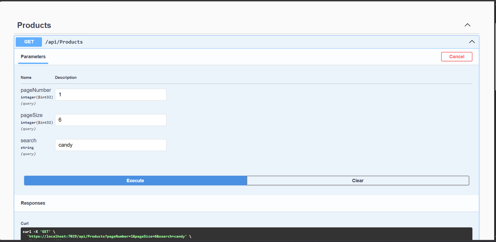
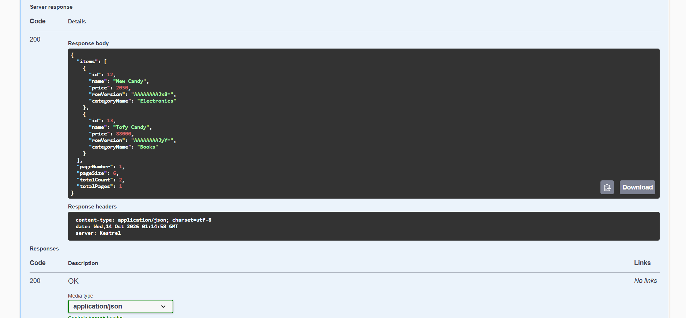
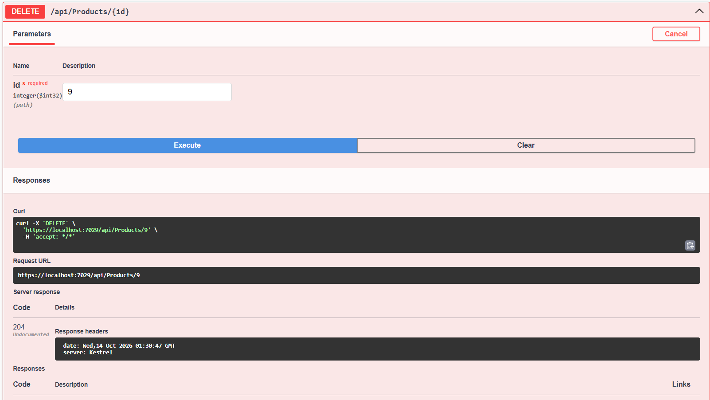

# Advanced EF Core: Huma Volve Intership Task 2 (Product API)

A small ASP.NET Core Web API built to practice **Entity Framework Core change tracking, query performance, soft delete and optimistic concurrency** on a simple `Product` / `Category` domain.

This project was built step by step during Day 2 of a work-simulation training. Every feature below maps to one concept, and the reasoning behind each choice is written down so the code is easy to review.

## Tech stack

- ASP.NET Core Web API
- Entity Framework Core (Code First, migrations)
- SQL Server
- Swagger UI for testing

## Features

| Feature | Where it lives |
|---|---|
| Paged and searchable product list | `GET /api/products` |
| Safe update of allowed fields only | `PUT /api/products/{id}` |
| Soft delete | `DELETE /api/products/{id}` |
| Automatic `CreatedAt` / `UpdatedAt` | `AppDbContext.SaveChangesAsync` override |
| Global query filter for deleted products | `AppDbContext.OnModelCreating` |
| Index on `Product.Name` | `AppDbContext.OnModelCreating` |
| Concurrency token (`RowVersion`) | `Product` entity + `PUT` endpoint |

## API endpoints

### `GET /api/products`

Query parameters: `pageNumber` (default 1), `pageSize` (default 10, capped at 50), `search` (optional, matches part of the product name).

Returns a paged result with `items`, `pageNumber`, `pageSize`, `totalCount` and `totalPages`. Each item contains the product id, name, price, **category name** and `rowVersion`.

### `PUT /api/products/{id}`

Body: `name`, `price`, `categoryId`, `rowVersion`.

- `404` if the product does not exist (or is soft-deleted)
- `400` if the category does not exist
- `409 Conflict` if someone else changed the product since the client loaded it
- `204` on success

### `DELETE /api/products/{id}`

Marks the product as deleted (`IsDeleted = true`). The row stays in the database.

- `404` if the product does not exist or is already deleted
- `204` on success

## Design decisions

### 1. Read endpoints: `AsNoTracking` + `Select` projection

The list endpoint only reads data, so there is no reason for the `ChangeTracker` to keep a copy of every row. It uses `AsNoTracking()` and projects straight into a `ProductDto`, so SQL Server only returns the columns the API actually exposes. It also keeps fields like `IsDeleted` and `CreatedAt` out of the response.

### 2. No N+1 queries for the category name

The category name is read inside the same `Select` (`p.Category.Name`), which EF Core translates into a single query with a JOIN. Loading the products first and then fetching each category in a loop would cost one extra query per product. I compared both versions by counting the SQL commands in the EF Core log.

### 3. Pagination

`OrderBy(Id)` -> `Skip` -> `Take`, with the page size capped at 50 so a client cannot ask for an unbounded number of rows. The ordering is required so pages are stable and do not overlap. `totalCount` is calculated after the search filter, so it matches what the client is searching.

### 4. Index on `Product.Name`

`Name` is the field users search by, so it is the most useful candidate for an index. `Id` is already indexed as the primary key, and `Price` is rarely searched by exact value.

Trade-off I want to be honest about: the current search uses `Contains`, which becomes `LIKE '%text%'`. A leading wildcard prevents SQL Server from doing an efficient index seek, so the index mainly helps exact matches and "starts with" searches. Switching the search to `StartsWith` would let it use the index fully. An index also costs disk space and makes inserts and updates slightly slower, so it should be added for real query patterns.

### 5. Soft delete with a global query filter

Products are never physically deleted. `DELETE` sets `IsDeleted = true`, and a global query filter (`HasQueryFilter(p => !p.IsDeleted)`) hides deleted products from every query automatically, so no endpoint can forget the check.

Notes:
- Lookups that must respect the filter use `FirstOrDefaultAsync`. `FindAsync` looks up by primary key and does not reliably apply the filter.
- `IgnoreQueryFilters()` bypasses the protection, so it should only be used where there is a clear reason and proper permissions.

### 6. Safe updates: DTO + load-then-modify

The PUT endpoint accepts an `UpdateProductDto` with only the editable fields, loads the real entity, and copies those fields onto it. I deliberately avoided `_context.Update(new Product { ... })`: on a detached object, EF Core marks **all** properties as modified, so every field the client did not send gets overwritten with its C# default. In my experiment this silently un-deleted a soft-deleted product and moved it to another category without any error.

### 7. Optimistic concurrency with `RowVersion`

`Product` has a `[Timestamp] byte[] RowVersion`. The client sends back the `rowVersion` it received, and the endpoint sets it as the property's `OriginalValue`, so EF Core generates `UPDATE ... WHERE Id = @id AND RowVersion = @clientVersion`. If another user saved first, no row matches, EF Core throws `DbUpdateConcurrencyException`, and the API returns `409 Conflict`.

Without setting `OriginalValue`, EF Core would compare against the version it loaded a moment ago in the same request, and conflicts would never be detected.

Optimistic concurrency fits here because users edit forms for a long time and conflicts are rare. Database locks are better for very short critical sections (for example decrementing stock), and should never be held while waiting for a human.

### 8. Automatic audit timestamps

`AppDbContext` overrides `SaveChangesAsync` and uses `ChangeTracker.Entries<EntityBase>()` to set `CreatedAt` when an entity is `Added` and `UpdatedAt` when it is `Modified`, in UTC. `CreatedAt` is explicitly protected from being modified. Every endpoint gets this behavior without repeating the code.

## Concepts practiced

| Concept | What I learned |
|---|---|
| ChangeTracker states | Added, Unchanged, Modified, Deleted, Detached, and when entities move between them |
| Original vs current values | How `SaveChanges` decides which columns to update |
| Tracking vs `AsNoTracking` | Why read-only queries should not be tracked |
| `ToQueryString` / EF logging | Checking the SQL that EF Core really sends |
| `Include`, N+1, `AsSplitQuery` | When to join, when to project, and when to split |
| Transactions | Why a single `SaveChanges` is already atomic, and when an explicit transaction is needed |
| Concurrency tokens | Detecting lost updates with `RowVersion` |
| Query filters and indexes | Soft delete and search performance |

## Screenshots

**Pagination and search**




**Soft delete**



## Running the project

1. Clone the repository.
2. Update the SQL Server connection string in `appsettings.json` to match your machine.
3. Apply the migrations:
   ```
   dotnet ef database update
   ```
4. Run the API:
   ```
   dotnet run
   ```
5. Open Swagger at `https://localhost:7029/swagger` (the port may differ on your machine, check the console output).

The database is seeded with 3 categories and 10 products.

## Testing the concurrency conflict

1. Call `GET /api/products` and copy a product's `rowVersion`.
2. Send a `PUT` for that product with the copied `rowVersion`. Expected: `204`.
3. Send a second `PUT` for the same product with the **same old** `rowVersion`. Expected: `409 Conflict`.
4. `GET` the product again to get the fresh `rowVersion`, then retry. Expected: `204`.

## Possible next steps

- Move the data access into a service layer
- Switch the search to `StartsWith` (or add full-text search) so the index is fully used
- Add a `POST` endpoint with validation
- Add integration tests for the concurrency and soft-delete behavior

## Author

Built by Mariam Ebrahim 
